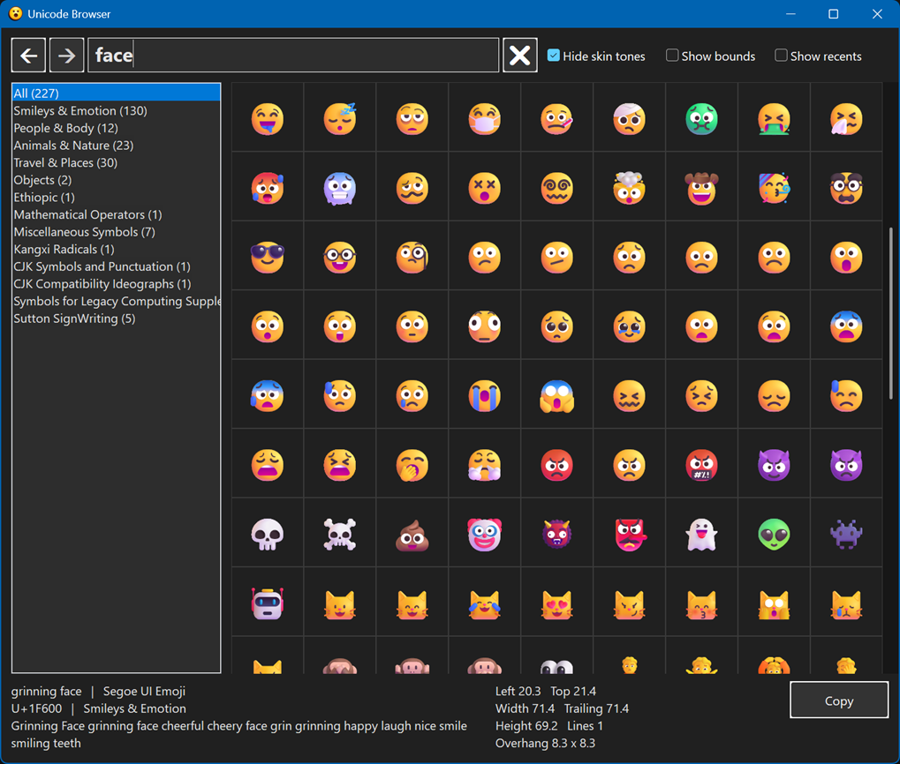

# Unicode Browser

A fast, searchable Unicode and emoji browser for Windows, written in AutoHotkey v2.1. Type a word, see every matching character, and copy the one you want to the clipboard by double clicking it.



## Features

- **Search everything**: filter by name, CLDR keywords, Unicode block or emoji group, or the character itself. Words are ANDed, so `arrow double` finds characters that match both. User uppercase OR to search for either entry.
- **Search by code point**: a term starting with `u+` matches code points, e.g. `u+1f60` or `arrow u+219`.
- **Group list**: the panel on the left lists every block or emoji group that has hits in the current search, with counts. Click one to narrow the grid to it. With an empty search box it lists every group, so you can browse a block without typing.
- **Color emoji**: the grid is drawn with Direct2D/DirectWrite, so emoji render in full color, including ZWJ sequences, flags and skin-tone variants.
- **Smooth with large result sets**: only the visible cells are drawn, so scrolling through thousands of characters stays quick.
- **Character details**: the info panel shows the selected character's name, the font it was actually drawn with (including any substituted fallback font), its code points, its group and its keywords. Metrics (bounds, advance, overhang) are shown alongside.
- **Recents**: characters you copy are remembered (up to 120) and can be shown with **Show recents**.
- **Search history**: the back and forward buttons step through previous searches.
- **Hide skin tones**: hides the skin-tone variants of emoji to keep results short.
- **Show bounds**: outlines each glyph's ink bounds in its cell to indicate the space they actually take up in text.
- **Custom fallback fonts**: make DirectWrite use fonts you've installed, such as Symbola or Noto, for characters the built-in Windows fonts lack (see [Configuration](#configuration)).
- **Dark theme** and per-monitor DPI awareness.
- **Tray icon**: click it to hide or restore the window.

## Requirements

- Windows 10 or 11 (custom fallback fonts need Windows 8.1 or later)
- To run from source: [AutoHotkey v2.1](https://www.autohotkey.com/) (alpha). The script uses v2.1 features such as `struct`, so v2.0 won't run it.
- To run the compiled `UnicodeBrowser.exe`: nothing else

## Getting started

1. Clone the repository, or download `UnicodeBrowser.exe` together with `tray.ico`.
2. Run `UnicodeBrowser.ahk2` with AutoHotkey v2.1, or run `UnicodeBrowser.exe`.
3. If the Unicode data files aren't in `UnicodeData\`, the app asks before downloading them (see [Data sources](#data-sources)).
4. Type in the search box, or pick a group on the left.

## Usage

| Action | How |
| --- | --- |
| Select a character | Click it, or use the arrow keys |
| Copy the selected character | Double-click, right-click, Enter, or the **Copy** button |
| Scroll | Mouse wheel over the grid, or the scroll bar |
| Clear the search | The ✖ button, or Ctrl+Backspace in the search box |
| Previous or next search | The ← and → buttons |
| Show only one group | Click the group in the left panel |
| Filter by the selected character's group | Click the info text at the bottom |
| Copy the code point (e.g. `U+1F600`) | Right-click the info text |

The arrow keys move the selection whenever the mouse is over the grid, even while the search box has focus.

## Configuration

Settings are stored in `UnicodeBrowser.ini` next to the script or executable. The window size and checkbox states are saved automatically. These settings are edited by hand, in the `[Settings]` section:

| Key | Default | Meaning |
| --- | --- | --- |
| `Font Size` | `26` | Glyph size in the grid (10–80) |
| `Fallback Fonts` | *(empty)* | Comma-separated font families to use when no built-in Windows font has a character, e.g. `Symbola, Noto Sans Symbols 2` |
| `Fallback First` | `0` | `1` tries the fallback fonts before the Windows fallback fonts. The primary font (Segoe UI) still wins for characters it has. |

### Why fallback fonts are needed

DirectWrite's built-in font fallback only uses a fixed list of fonts that ship with Windows. A font you install yourself is never used for substitution, so characters only it covers still show as empty boxes. Add the font to `Fallback Fonts` and restart the browser.

```ini
[Settings]
Fallback Fonts=Symbola, Noto Sans Symbols 2
```

## Data sources

The character data is downloaded from the Unicode Consortium once and cached in `UnicodeData\`. To refresh it to the latest Unicode version, delete that folder and restart.

| File | Source | Used for |
| --- | --- | --- |
| `emoji-test.txt` | [unicode.org](https://www.unicode.org/Public/emoji/latest/emoji-test.txt) | Emoji names, groups, ZWJ, flag and skin-tone sequences |
| `UnicodeData.txt` | [unicode.org](https://www.unicode.org/Public/UCD/latest/ucd/UnicodeData.txt) | Names of every individually named character |
| `Blocks.txt` | [unicode.org](https://www.unicode.org/Public/UCD/latest/ucd/Blocks.txt) | Block names, used as groups for non-emoji characters |
| `annotations-en.json`, `annotations-derived-en.json` | [unicode-org/cldr-json](https://github.com/unicode-org/cldr-json) | English keywords and spoken names |

## Building

`build.bat` compiles the script into `UnicodeBrowser.exe` with Ahk2Exe. It requres an alpha 2.1 version 30 or later. It closes a running copy first and restarts it afterwards. Edit the Ahk2Exe and AutoHotkey base paths in the batch file to match your install (`C:\Apps\AHK\V2\` by default).

## Project layout

| Path | Contents |
| --- | --- |
| `UnicodeBrowser.ahk2` | The application |
| `clsD2D.ahk2` | Thin Direct2D/DirectWrite COM wrapper |
| `UnicodeData\` | Cached Unicode and CLDR data files |
| `tray.ico` | Application and tray icon |
| `build.bat` | Compiles the executable |

## License

Copyright © 2026 Tom Wilkason. <!-- TODO: choose a license and add a LICENSE file -->

Unicode data files are © Unicode, Inc. and are distributed under the [Unicode License](https://www.unicode.org/license.txt).
